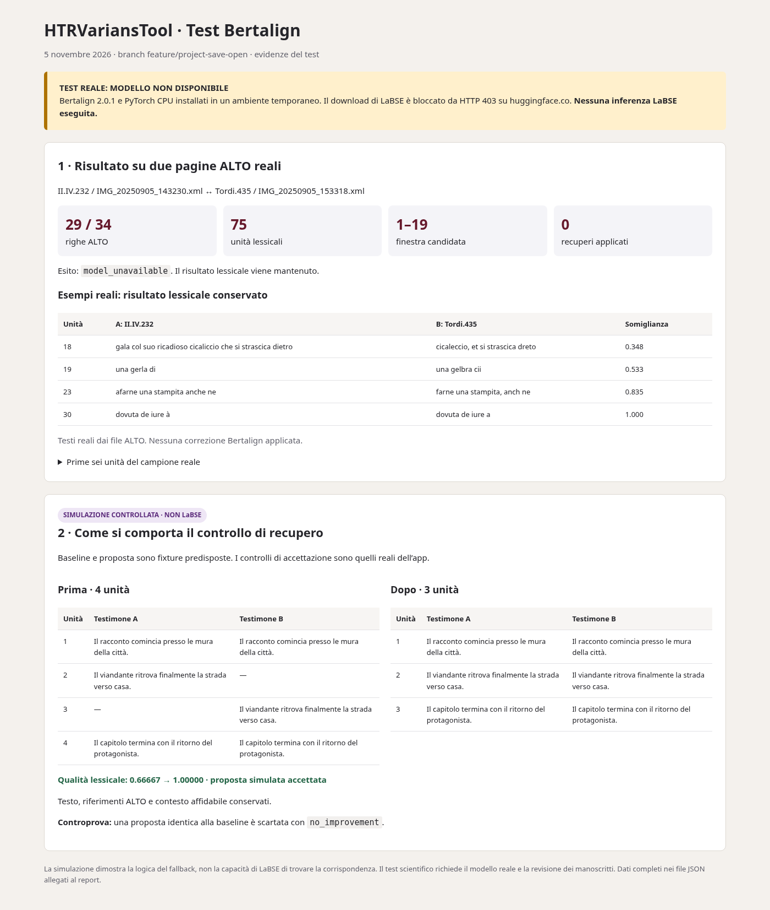

# Test visibile Bertalign — 5 novembre 2026

**Esito del tentativo reale: modello non disponibile. Nessuna inferenza LaBSE eseguita.**



## 1. Confronto reale su ALTO del repository

| Voce | Risultato osservato |
|---|---|
| Riferimento | `samples/Malmantile_II.IV.232/IMG_20250905_143230.xml` |
| Testimone confrontato | `samples/Malmantile_Tordi.435/IMG_20250905_153318.xml` |
| Righe ALTO | 29 contro 34 |
| Unità di revisione lessicali | 75 |
| Finestre candidate automatiche | 1 |
| Finestra candidata | unità 1–19 |
| Primo ambiente, senza pacchetto | `not_installed`; risultato lessicale conservato |
| Ambiente temporaneo con Bertalign 2.0.1 e PyTorch CPU | `model_unavailable` |
| Caricamento modello | bloccato da HTTP **403** su `huggingface.co` |
| Modifiche semantiche applicate al campione reale | **0** |
| Inferenza reale LaBSE | **non eseguita** |

## Esempi effettivi dell’allineamento lessicale mantenuto

Questi testi provengono dai due ALTO reali; nessuna correzione Bertalign è stata applicata.

| Unità | A: II.IV.232 | B: Tordi.435 | Somiglianza lessicale |
|---|---|---|---|
| 18 | gala col suo ricadioso cicaliccio che si strascica dietro | cicaleccio, et si strascica dreto | 0.348 |
| 19 | una gerla di | una gelbra cii | 0.533 |
| 23 | afarne una stampita anche ne | farne una stampita, anch ne | 0.835 |
| 30 | dovuta de iure à | dovuta de iure a | 1.000 |

Il confronto lessicale più la ricerca dei passi spostati ha richiesto 40.337 s in questo ambiente (comprende la costruzione della baseline e il normale percorso API). Il tentativo isolato di caricare il runtime/modello ha richiesto 8.874 s. Questi tempi **non sono tempi di inferenza LaBSE**.

[Output completo del campione](sample-result.json) · [Tentativo con runtime installato](runtime-attempt.json)

## 2. Dimostrazione controllata del meccanismo — NON è un risultato LaBSE

L’allineamento iniziale e la proposta semantica di questo esempio sono predisposti come fixture. Il codice che controlla conservazione del testo, riferimenti, contesto affidabile e miglioramento è quello reale dell’applicazione.

### Prima

| Unità | A | B |
|---|---|---|
| 1 | Il racconto comincia presso le mura della città. | Il racconto comincia presso le mura della città. |
| 2 | Il viandante ritrova finalmente la strada verso casa. | — |
| 3 | — | Il viandante ritrova finalmente la strada verso casa. |
| 4 | Il capitolo termina con il ritorno del protagonista. | Il capitolo termina con il ritorno del protagonista. |

### Dopo la proposta simulata accettata

| Unità | A | B |
|---|---|---|
| 1 | Il racconto comincia presso le mura della città. | Il racconto comincia presso le mura della città. |
| 2 | Il viandante ritrova finalmente la strada verso casa. | Il viandante ritrova finalmente la strada verso casa. |
| 3 | Il capitolo termina con il ritorno del protagonista. | Il capitolo termina con il ritorno del protagonista. |

- Qualità lessicale aggregata: **0.66667 → 1.00000**.
- Contesto iniziale e finale conservato; testo e riferimenti conservati.
- Esito del controllo: `applied`.
- Secondo caso controllato, proposta identica alla baseline: **`no_improvement`**, nessuna sostituzione.

Questa dimostrazione verifica il comportamento del fallback; **non dimostra che Bertalign trovi questa corrispondenza**.

[Dati della simulazione](controlled-demo.json) · [Report HTML completo](report.html)

## Come completare il test reale

È stata salvata una bozza delle impostazioni di rete per `huggingface.co`, `cas-bridge.xethub.hf.co`, `cas-server.xethub.hf.co` e `transfer.xethub.hf.co`. La bozza non modifica la rete corrente: va rivista, salvata e pubblicata nelle impostazioni dell’ambiente. Dopo l’attivazione occorre riprovare il download, verificare le eventuali altre destinazioni richieste e ripetere il confronto con LaBSE. Non è stata disabilitata alcuna verifica TLS.

In locale, usare il branch `feature/project-save-open` e il launcher `sh LANCER_LINUX.sh`, caricare i due ALTO sopra e leggere `semanticFallback` nell’export decisioni JSON. Finché il modello non gira, nessun confronto prima/dopo reale può essere attribuito a Bertalign.

### Riprodurre il confronto reale sul tuo computer

Dalla cartella principale del repository, dopo l’installazione tramite launcher:

```bash
.venv/bin/python reports/bertalign-2026-11-05/reproduce.py
```

Lo script usa **il percorso automatico reale**, senza simulazioni, e stampa dove
sono stati salvati `report.html` (apribile nel browser) e `result.json`. Se il
modello non si carica o non viene attivato, lo stato lo segnala esplicitamente.
Per scegliere altri file: `--a percorso/al/primo.xml --b percorso/al/secondo.xml`.

[Pacchetti del runtime temporaneo usato nel tentativo](runtime-packages.txt).
